# ESP32-S3 USB-to-BLE HID Keyboard Bridge

[](https://github.com/guneysogutt/ble-keyboard-bridge/actions/workflows/build.yml)
[](https://www.espressif.com/en/products/socs/esp32-s3)
[](https://github.com/espressif/esp-idf)
[](LICENSE)

A low-latency, dual-core firmware built on **ESP-IDF** that turns any wired USB keyboard into a wireless **Bluetooth Low Energy (BLE) HID keyboard** using an **ESP32-S3**.

By leveraging the ESP32-S3's native USB OTG peripheral in Host mode on Core 0 and the lightweight NimBLE stack in Peripheral (HOGP) mode on Core 1, this bridge captures raw USB HID keyboard reports and forwards them over BLE with minimal latency.

---

## Features

- **Native USB HID Host (`usb_hid_host`)**
  - Automatic USB keyboard detection, enumeration, and hot-plug support.
  - Filters composite USB devices to bind specifically to keyboard/boot interfaces.
  - Asynchronous device lifecycle worker task to configure `SET_PROTOCOL` (Boot Protocol) and `SET_IDLE` without blocking the USB Host driver callback.
- **BLE HID over GATT Profile — HOGP (`ble_hid_device`)**
  - Built on the low-footprint **NimBLE** host stack instead of Bluedroid.
  - Full **Apple (macOS/iOS), Windows, Linux, and Android compliance**, exposing mandatory Device Information (`0x180A` with `PnP ID`), Battery (`0x180F`), and Human Interface Device (`0x1812`) GATT services.
  - Supports both **Report Protocol Mode** and **Boot Keyboard Input Mode**.
  - **Persistent NVS Bonding** with Secure Connections ("Just Works" pairing and automatic repeat-pairing recovery).
- **Low-Latency Tuning**
  - Automatically negotiates a **7.5 ms – 15 ms** BLE connection interval (`0` slave latency) after GATT subscription completes—respecting Apple's connection parameter handshake timing rules.
  - Keeps the APB clock locked at 240 MHz (`CONFIG_PM_ENABLE=n`) so the USB Host PHY never drops frames during idle intervals.
- **Dual-Core FreeRTOS Architecture**
  - **Core 0**: Dedicated to USB Host Library daemon, HID driver background events, and USB device lifecycle management.
  - **Core 1**: Dedicated to the NimBLE host stack and the HID report consumer task, decoupled via a thread-safe FreeRTOS queue.

---

## System Architecture

```mermaid
flowchart LR
    subgraph USB["Wired USB Domain"]
        KB["USB Mechanical Keyboard"]
    end

    subgraph ESP32S3["ESP32-S3 SoC"]
        subgraph Core0["Core 0 (USB Host Subsystem)"]
            USBD["USB Host Daemon"]
            HIDH["HID Host Driver & Worker"]
        end

        Q[("FreeRTOS Queue\n(16 x 8-byte Reports)")]

        subgraph Core1["Core 1 (BLE Subsystem)"]
            CONS["Keyboard Consumer Task"]
            NIM["NimBLE GATT / HOGP Server"]
        end
    end

    subgraph BLE["Wireless BLE Domain"]
        HOST["Host Device\n(macOS / Windows / Linux / iOS / Android)"]
    end

    KB -- "USB D+ / D-\n(8-byte Boot Report)" --> USBD
    USBD --> HIDH
    HIDH -- "xQueueSend()" --> Q
    Q -- "xQueueReceive()" --> CONS
    CONS -- "ble_gatts_notify_custom()" --> NIM
    NIM -- "BLE 7.5-15ms Interval\n(HOGP 0x1812)" --> HOST
```



---

## Hardware Requirements & Wiring

### Required Hardware
1. **ESP32-S3 Development Board** (e.g., `ESP32-S3-DevKitC-1` or custom PCB with native USB OTG exposed).
2. **USB Keyboard** (standard 6KRO / Boot Protocol compatible mechanical or membrane keyboard).
3. **USB OTG Adapter / Cable** (if connecting to the DevKit's USB-OTG port).

### USB OTG Pinout (ESP32-S3)

| Signal | ESP32-S3 GPIO | Description |
| :--- | :--- | :--- |
| **USB D-** | `GPIO 19` | Native USB OTG Data Minus |
| **USB D+** | `GPIO 20` | Native USB OTG Data Plus |
| **VBUS (5V)** | `5V / VBUS` | 5V power supply to the downstream USB keyboard |
| **GND** | `GND` | Common ground |

> [!IMPORTANT]
> **Powering the USB Keyboard (VBUS):**
> On many `ESP32-S3-DevKitC` boards, the micro-USB / USB-C **USB OTG** port does not output 5V by default unless the `USB-OTG 5V` solder jumper is bridged or the board is powered via the `UART` port / `5V` pin. Ensure your USB keyboard receives 5V power on VBUS.

---

## Getting Started

### 1. Prerequisites
- [ESP-IDF](https://docs.espressif.com/projects/esp-idf/en/latest/esp32s3/get-started/) **v5.5+** (or v6.x).
- CMake & Ninja (installed automatically with ESP-IDF).

### 2. Clone & Configure
```bash
git clone https://github.com/guneysogutt/ble-keyboard-bridge.git
cd ble-keyboard-bridge

# Activate your ESP-IDF environment
. $HOME/esp/esp-idf/export.sh

# Set target to ESP32-S3 (applies sdkconfig.defaults automatically)
idf.py set-target esp32s3
```

### 3. Build, Flash & Monitor
Connect your ESP32-S3 board via the **UART** port for flashing and serial logging, and plug your keyboard into the **USB** (OTG) port:

```bash
idf.py build
idf.py -p <PORT> flash monitor
```
*(Replace `<PORT>` with your serial port, e.g. `/dev/cu.usbserial-*` on macOS or `/dev/ttyACM0` / `/dev/ttyUSB0` on Linux).*

### 4. Pairing over Bluetooth
1. Once booted, the ESP32-S3 begins advertising as **`Wireless Mechanical KB`**.
2. Open Bluetooth settings on your computer, tablet, or phone and select **`Wireless Mechanical KB`**.
3. After pairing completes, any keystrokes typed on the physical USB keyboard are immediately transmitted over BLE.

> **Customizing the Bluetooth Device Name:**
> Edit the name passed to `ble_hid_init()` in [`main/main.c`](main/main.c):
> ```c
> ESP_ERROR_CHECK(ble_hid_init("Wireless Mechanical KB"));
> ```

---

## Project Structure

```text
ble-keyboard-bridge/
├── .github/workflows/
│   └── build.yml                  # CI workflow for automated ESP-IDF firmware builds
├── components/
│   ├── battery_monitor/           # Battery voltage / percentage monitor interface (ADC stub)
│   │   ├── battery.c
│   │   ├── include/battery.h
│   │   └── CMakeLists.txt
│   ├── ble_hid_device/            # NimBLE HOGP peripheral, GATT services, pairing & advertising
│   │   ├── ble_hid.c
│   │   ├── include/ble_hid.h
│   │   └── CMakeLists.txt
│   └── usb_hid_host/              # USB OTG Host daemon, HID class driver & device worker
│       ├── usb_hid_host.c
│       ├── include/usb_hid_host.h
│       └── CMakeLists.txt
├── main/
│   ├── main.c                     # Application entry point, NVS init, queue & task setup
│   ├── idf_component.yml          # Managed component dependencies (espressif/usb_host_hid)
│   └── CMakeLists.txt
├── CMakeLists.txt                 # Top-level ESP-IDF project CMake file
├── sdkconfig.defaults             # Default Kconfig settings (NimBLE, 240MHz, 1000Hz Tick, PM off)
└── LICENSE                        # Apache-2.0 License
```

---

## Roadmap & Known Limitations

- [x] USB Host HID Boot Protocol keyboard enumeration and input report capture
- [x] NimBLE HID-over-GATT (HOGP) server with macOS / Windows / Android compatibility
- [x] Persistent NVS bonding & automatic reconnection
- [x] Low-latency BLE connection parameter negotiation (7.5 ms – 15 ms)
- [ ] **ADC Battery Monitoring**: `components/battery_monitor` currently returns a static `100%` (`4200 mV`) placeholder; hardware ADC divider reading and periodic BLE Battery Level notifications are planned.
- [ ] **HID Output Reports**: Forwarding Caps Lock / Num Lock / Scroll Lock LED states from BLE host back to the physical USB keyboard.
- [ ] **Consumer Control & NKRO**: Extending the HID Report Map to support multimedia keys (Volume, Play/Pause) and N-Key Rollover reports.

---

## License

This project is licensed under the **Apache License 2.0** — see the [LICENSE](LICENSE) file for details.
